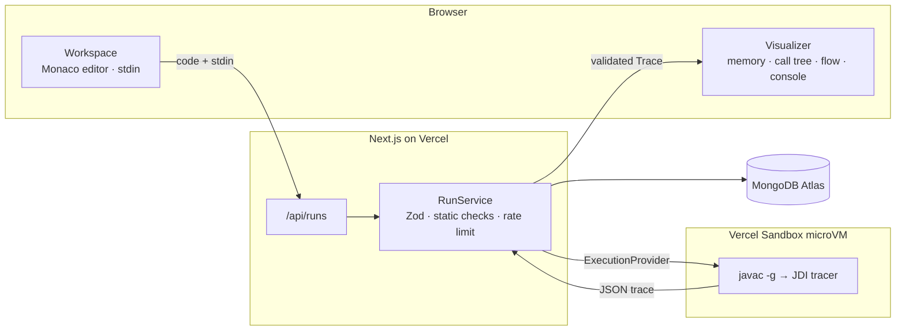

# mycodevisualizer

See Java code run, one line at a time. A free, open tool that helps Coding 101 students understand what the computer does: variables changing, methods being called, arrays living in memory, input being read.

Paste code, add input, press **Visualize**, then step through it or let it play.

## Features
- **Real Java**, compiled and run in an isolated Vercel Sandbox microVM, traced line by line with a JDI debugger.
- **Step-by-step or automated** playback with speed control, a timeline scrubber, breakpoints (click the gutter) and keyboard shortcuts (Space, ←/→, Home/End, B).
- **Memory view**: call stack frames with local variables, arrays and objects on the heap, arrows for references (so aliasing is visible).
- **Collections**: `ArrayList`, `LinkedList`, `HashSet`, `TreeSet`, `HashMap`, `TreeMap`, `LinkedHashMap`, `ArrayDeque`, `Stack`, `PriorityQueue`, `List.of`/`Map.of` and more, shown as lists, sets and key → value tables. Added elements glow, replaced values show what they were, removed elements linger for a step.
- **Call tree** for recursion, with return values, as a tree diagram or an outline.
- **Flowchart** of each method, highlighting the path the program actually took.
- **Plain-English notes** for every step ("The loop condition i < nums.length is true (i is 0), so its body runs.").
- **Console and input tape** showing output so far and which input tokens Scanner has consumed.
- Beginner-friendly explanations of **compile errors** and **exceptions**.
- 22 curated **examples**, shareable **links**, optional **GitHub / Google sign-in** to keep your shared programs.
- **Themes**: Light, Dim (soft gray, easy on large screens and TVs) and Black, plus a selectable accent color.
- **Adjustable layout**: drag the dividers between code, input, visualization and console (sizes are remembered), and zoom the code and the memory / call tree views independently.

## Stack
Next.js 16 (App Router) · TypeScript · Tailwind CSS 4 · shadcn/ui (Radix) · Monaco · React Flow · MongoDB Atlas · Auth.js · Vercel + Vercel Sandbox · Zod · Vitest · Playwright.

## Architecture



User code never runs on the web server: each run gets a throwaway microVM with no network. The browser receives one validated JSON trace and does all playback, notes and drawing locally, so stepping back and scrubbing are instant.

**[docs/ARCHITECTURE.md](docs/ARCHITECTURE.md)** has the detailed diagrams: code layers, the full request sequence, the tracer internals, the client rendering pipeline, execution providers, the data model, sharing and security boundaries.

### Project layout
| Path | What lives there |
| --- | --- |
| `src/app` | Routes only: pages and thin route handlers |
| `src/features/*` | UI slices (`workspace`, `editor`, `visualizer`, `snippets`, `examples`, `auth`, `theme`), imported through `index.ts` |
| `src/components` | shadcn/ui primitives and shared pieces (header, split handle, zoom controls) |
| `src/languages/*` | One `LanguageAdapter` per language; register in `registry.ts` |
| `src/server` | Server-only: composition root, services, execution providers, repositories, security |
| `src/shared` | Isomorphic contracts: constants, Zod schemas for trace, API and examples |
| `tracer/` | Java JDI tracer, built with plain `javac` |
| `content/examples` | Curated example programs |
| `docs/` | Product spec and architecture |

## Local development
Requirements: Node 22+, Yarn 4 (`corepack enable`), JDK 21.

```bash
yarn install
yarn tracer:build          # builds tracer/build/tracer.jar
cp .env.example .env.local # everything is optional for local dev
yarn dev
```

Without `MONGODB_URI` the app still works: examples come from `/content/examples`, sharing and sign-in are hidden, rate limits are kept in memory. In development, code runs through the `local` provider (the tracer jar on your machine). It is refused in production.

## Deploying to Vercel
1. Import the repo into Vercel (framework: Next.js).
2. Create a MongoDB Atlas cluster and set `MONGODB_URI`.
3. Set `AUTH_SECRET`, `IP_HASH_SALT` (and optionally GitHub/Google OAuth credentials, with callback URL `https://<your-domain>/api/auth/callback/<provider>`).
4. Run `yarn db:setup` and `yarn db:seed` once against the database.
5. The Java runtime snapshot is built automatically on first use (about a minute) and recorded in MongoDB. You can build it ahead of time with `yarn sandbox:snapshot`.

## Scripts
| Script | What it does |
| --- | --- |
| `yarn check` | Lint, typecheck, unit tests |
| `yarn test:e2e` | Playwright tests (desktop + mobile) |
| `yarn tracer:test` | Runs the Java tracer against `tracer/src/test/programs` |
| `yarn db:setup` / `yarn db:seed` | Create indexes / load examples |
| `yarn sandbox:snapshot` | Build the JDK + tracer sandbox snapshot |

## Security
User code only runs inside throwaway microVMs with no network access, an 8 s tracing budget, 128 MB heap and 1,000-step cap. The API validates every input with Zod, rejects cross-origin writes, caps request sizes, rate-limits by hashed IP, sends a strict CSP and security headers, and never stores raw IPs. See `CLAUDE.md` for coding rules.

## Adding a language
Implement `LanguageAdapter` in `src/languages/<lang>/`, register it in `src/languages/registry.ts`, add a tracer that emits the `Trace` schema (`src/shared/trace/schema.ts`), and include it in the sandbox runtime.

## License
MIT
