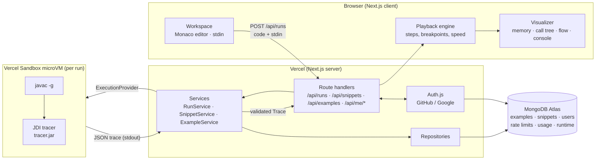
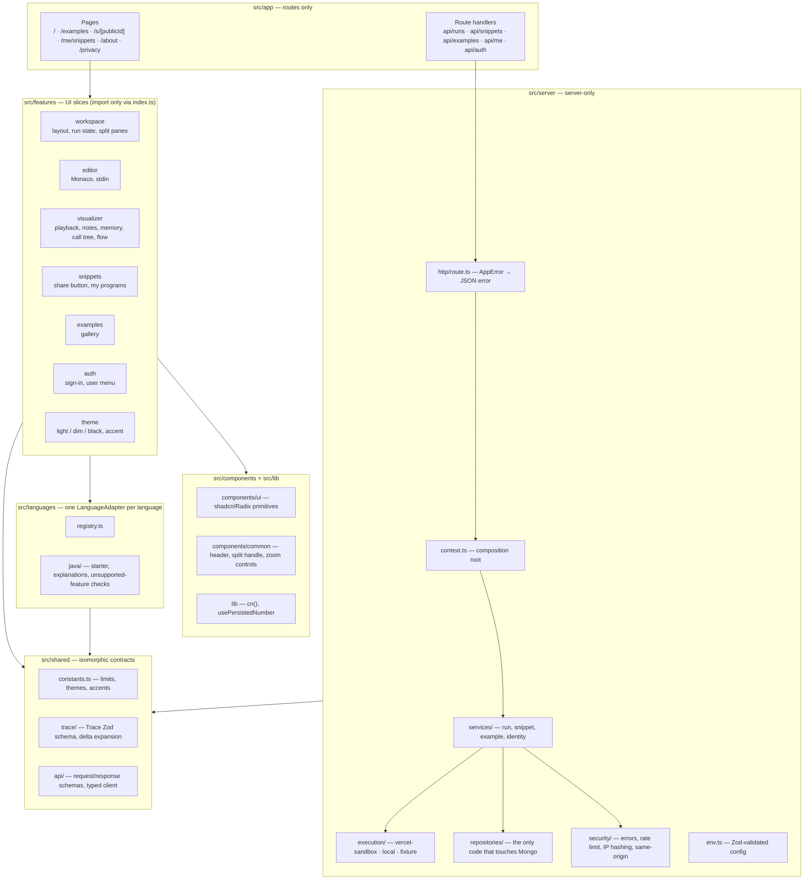
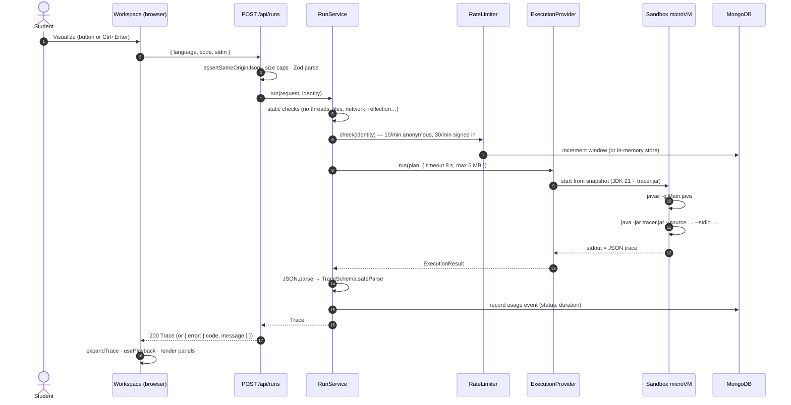
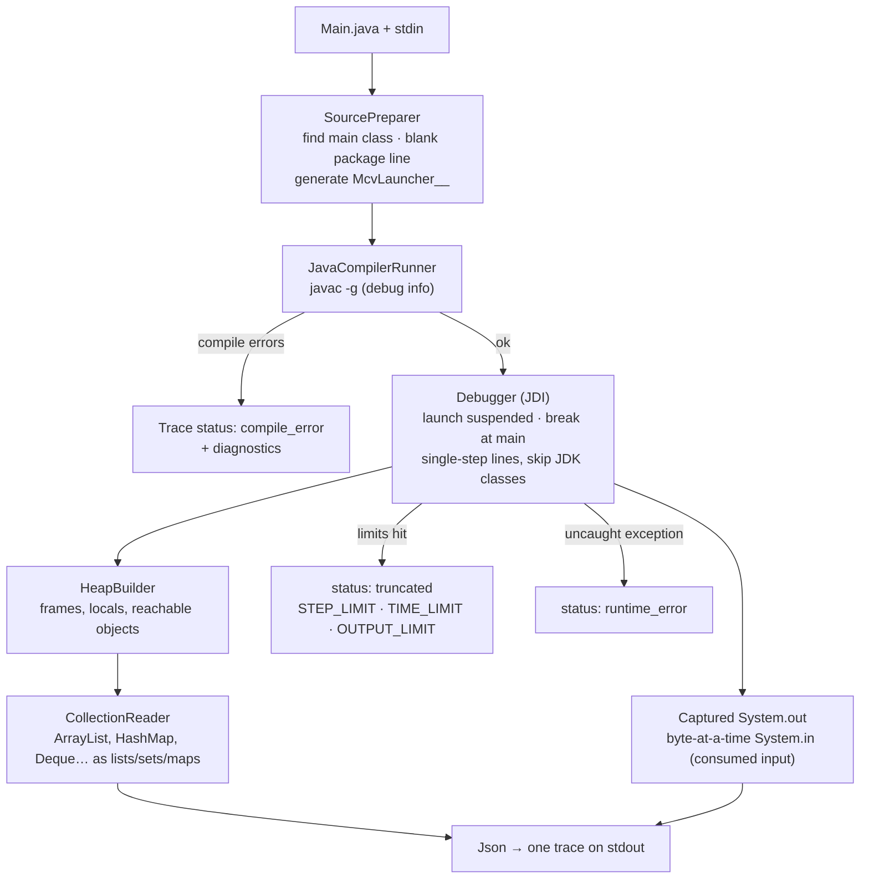
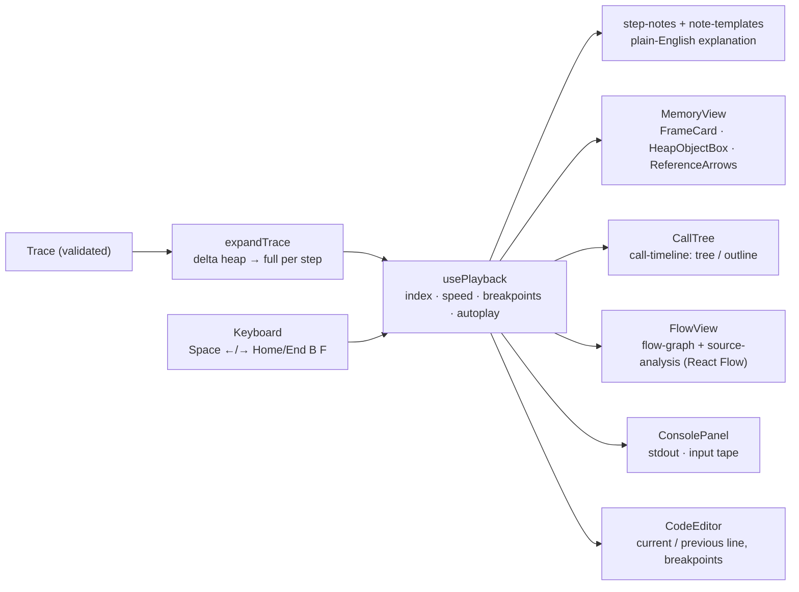
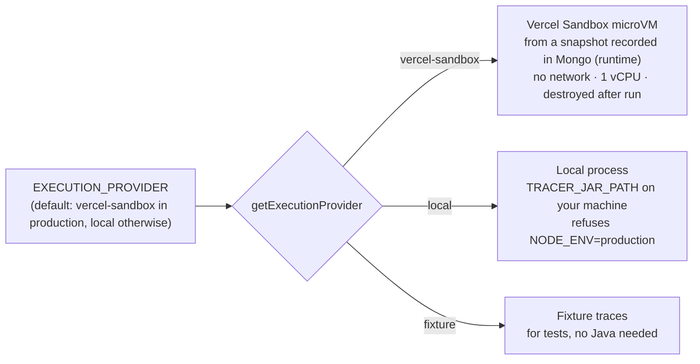
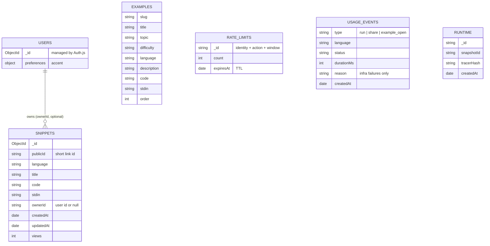
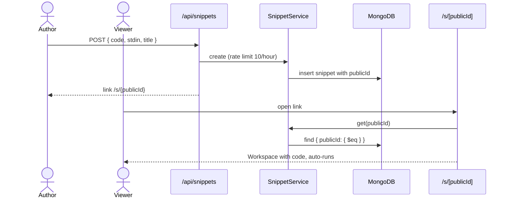
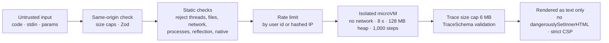

# Architecture

How mycodevisualizer is put together, from the browser down to the Java tracer. Diagrams are [Mermaid](https://mermaid.js.org) and render on GitHub.

- [System overview](#system-overview)
- [Code layers](#code-layers)
- [Lifecycle of a run](#lifecycle-of-a-run)
- [Inside the sandbox: the tracer](#inside-the-sandbox-the-tracer)
- [In the browser: from trace to pictures](#in-the-browser-from-trace-to-pictures)
- [Execution providers](#execution-providers)
- [Data model](#data-model)
- [Sharing and accounts](#sharing-and-accounts)
- [Security boundaries](#security-boundaries)
- [UI state that stays in the browser](#ui-state-that-stays-in-the-browser)

## System overview

The server never runs user code itself. It validates the request, hands the program to an isolated microVM, and validates the JSON trace that comes back. Everything visual (step notes, memory drawing, call tree, flowchart, playback) is computed in the browser from that one trace.

## Code layers

Rules that keep the layers honest (see `CLAUDE.md`):

- Pages and route handlers stay thin and call services from `context.ts`.
- Services never touch the Mongo driver; repositories do.
- A feature slice is imported only through its `index.ts` (ESLint enforces it).
- The UI only sees `Trace`, never anything Java-specific from the server.
- Every boundary (env, request bodies, DB documents, trace JSON) is parsed with Zod.

## Lifecycle of a run

Failures surface as `AppError(code, safeMessage)` and are mapped by `route()` to `{ error: { code, message } }`. Codes include `UNSUPPORTED_FEATURE`, `RATE_LIMITED` and `EXECUTION_FAILED`.

## Inside the sandbox: the tracer

Each step records the event (`call`, `step`, `return`, `exception`, `end`), the line, stack frames with locals, the heap (full or delta-encoded), output so far and how much stdin has been consumed. The tracer has no third-party dependencies, only `jdk.jdi` and `java.compiler`.

## In the browser: from trace to pictures

All of this is deterministic and runs client-side, so stepping backwards and scrubbing are instant and need no server round trips.

## Execution providers

The sandbox snapshot (JDK 21 + `tracer.jar`) is built on first use and its id stored in the `runtime` collection, or built ahead of time with `yarn sandbox:snapshot`.

## Data model

Mongo is optional in development. Without `MONGODB_URI`, examples load from `content/examples`, sharing and sign-in are hidden, and rate limits use an in-memory store.

## Sharing and accounts

Signed-in users see their shared programs at `/me/snippets`, and their accent color is saved to their profile via `/api/me/preferences`.

## Security boundaries

Raw IPs are never stored, Mongo filters use `$eq` on user input, and the `local` provider cannot run in production.

## UI state that stays in the browser

These preferences live in `localStorage` (per browser) and are applied before paint where they affect colors:

| Key | What |
| --- | --- |
| `mcv-theme` | Light, Dim or Black theme |
| `mcv-accent` | Accent color (also saved to the account when signed in) |
| `mcv-code-width` | Code / visualization split |
| `mcv-editor-height` | Editor / stdin split |
| `mcv-tabs-height` | Visualization / console split |
| `mcv-code-zoom` | Code editor zoom |
| `mcv-viz-zoom` | Memory and call tree zoom |
